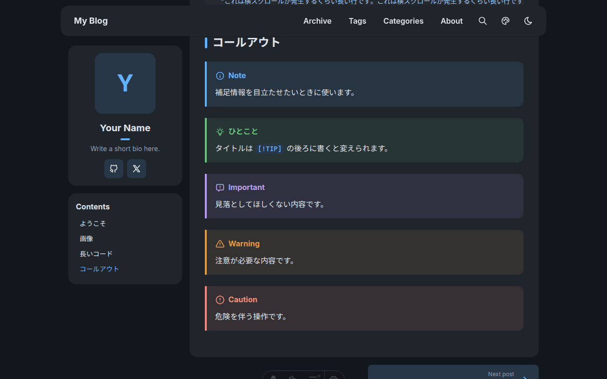
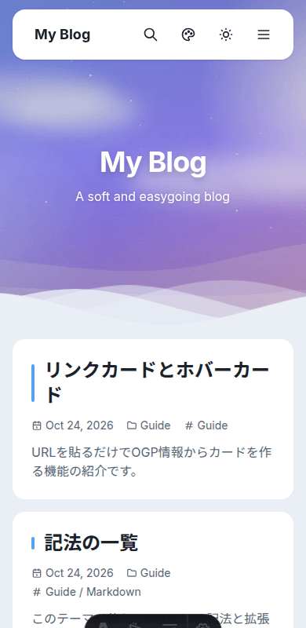

# Yurari

Yurari(ゆらり)は、[Fuwari](https://github.com/saicaca/fuwari) にインスパイアされた、やわらかい見た目の Astro 製ブログテーマです。

Astro 7 / Tailwind CSS v4 / TypeScript で作っています。

**[デモサイト](https://minittupoyo.github.io/astro-theme-yurari-demo/)**


<table>
  <tr>
    <td></td>
    <td width="220"></td>
  </tr>
</table>

## 特徴

- やわらかいカードUI、ダークモード、テーマカラー(色相)の変更
- トップページのヒーローセクション(波打つ境界)と、初回読み込み時の全画面イントロ
- ページ遷移アニメーション(`ClientRouter`)
- 記事一覧のページネーション、タグ・カテゴリ・アーカイブ、検索(`Ctrl/Cmd + K`)
- サイドバーのタグクラウド(記事数に応じて文字サイズが変わり、表示中のタグは強調される)
- 記事ページの目次、前後の記事、コードのコピーボタン、画像の拡大表示(ホイール/ピンチで拡大縮小・ドラッグ移動)
- Markdown 拡張: コールアウト、リンクカード、ホバーカード
- About ページ、RSS(`/rss.xml`)
- モバイル用メニュー
- 画像の最適化(WebP 変換、サイズ属性、遅延読み込み)
- [Keystatic](https://keystatic.com/) による管理画面(開発サーバー限定)

## はじめかた

必要なもの: Node.js 22.23.4 以上、[Bun](https://bun.sh/)

```sh
bun install
astro dev --background   # http://localhost:4321
```

| コマンド                             | 内容                                 |
| :----------------------------------- | :----------------------------------- |
| `bun install`                        | 依存関係のインストール               |
| `astro dev --background`             | 開発サーバーをバックグラウンドで起動 |
| `astro dev stop` / `status` / `logs` | バックグラウンドの開発サーバーの管理 |
| `bun run build`                      | 本番用ビルドを `./dist/` に出力      |
| `bun run preview`                    | ビルド結果のプレビュー               |

## サイトの設定

ほとんどの設定は `src/config.ts` にあります。

| 設定                                                         | 内容                                                                                                                                                             |
| :----------------------------------------------------------- | :--------------------------------------------------------------------------------------------------------------------------------------------------------------- |
| `siteConfig.title` / `subtitle` / `description`              | サイト名、サブタイトル、説明                                                                                                                                     |
| `siteConfig.pageSize`                                        | 1ページに表示する記事数                                                                                                                                          |
| `siteConfig.dateFormat` / `archiveDateFormat` / `dateLocale` | 日付の書式(`YYYY` `YY` `MMMM` `MMM` `MM` `M` `DD` `D`、`[ ]` で囲むとそのまま出力。例: `"YYYY-MM-DD"`、`"YYYY年M月D日"`)と、月名の言語(`"en-US"` `"ja-JP"` など) |
| `siteConfig.themeHue`                                        | テーマカラーの初期値(0〜360)。閲覧者はパレットから変更できる                                                                                                     |
| `siteConfig.hero`                                            | ヒーローの画像・タイトル・サブタイトル                                                                                                                           |
| `profileConfig`                                              | プロフィールの名前・画像・紹介文・SNSリンク                                                                                                                      |
| `navLinks`                                                   | ヘッダーのナビゲーション(PC・モバイル共通)                                                                                                                       |

### 画像

- **ヒーロー画像**: `src/assets/` に置き、`src/config.ts` で `import` して `hero.image` に渡します。
- **プロフィール画像**: `profileConfig.avatar` に、`src/assets` の画像を `import` したもの(最適化される)、または URL / `public` 配下のパスの文字列(そのまま表示)を指定します。空にすると名前の頭文字を表示します。
- **記事内の画像**: `src/assets/images/` に置き、`` のように参照すると、最適化されます。`public/` に置いた画像は最適化の対象外です。

## 記事の書きかた

`src/content/posts/` に Markdown ファイルを追加します。

```md
---
title: 記事のタイトル
published: 2026-10-24
description: 一覧や検索に出る説明
tags: [Astro, Guide]
category: Guide
draft: false # true にすると公開されない
---

本文
```

使える記法は、サンプル記事「記法の一覧」(`src/content/posts/markdown-guide.md`)で確認できます。

### 拡張記法

**コールアウト** — `> [!種類]` で始まる引用。種類は `NOTE` `TIP` `IMPORTANT` `WARNING` `CAUTION`。

```md
> [!TIP] タイトルを変える
> `[!TIP]` の後ろにタイトルを書けます。
```

**リンクカード** — URL だけの行は、OGP 情報からカードになります。

```md
https://astro.build
```

**ホバーカード** — 文中の外部リンクにマウスを乗せると、OGP のプレビューが出ます。

```md
[open-graph-scraper](https://github.com/jshemas/openGraphScraper)
```

OGP の取得にはビルド時に [open-graph-scraper](https://github.com/jshemas/openGraphScraper) を使い、結果は `.cache/ogp.json` に保存されます(再ビルドでは再取得しません)。取得に失敗したURLは、リンクカードならドメイン名だけの表示になり、ホバーカードは付きません。ビルドは止まりません。

### About ページ

`src/content/spec/about.md` を編集します。

## 管理画面 (Keystatic)

開発サーバーを起動して http://localhost:4321/keystatic を開くと、記事と About をブラウザから編集できます。保存すると `src/content/` のファイルに直接書き込まれます。貼り付けた画像は `src/assets/images/` に、UUID のファイル名で保存されます。

> [!NOTE]
> 管理画面は **開発サーバーでのみ有効** です(`astro.config.mjs` で `astro dev` のときだけ読み込み)。管理画面にはサーバーレンダリングが必要で、静的ビルドにはアダプターが要るためです。本番サイトでの編集が必要な場合は、アダプターの追加と、保存先を GitHub などにする設定が必要です。

## 公開(デプロイ)

`bun run build` で静的サイトが `dist/` に出力されます。Netlify、Vercel、Cloudflare Pages、GitHub Pages など、静的ファイルを配信できるところならどこでも公開できます。

公開URLとサブパスは、ビルド時に環境変数で渡します(未指定なら、サイトはルート `/` で動きます)。

| 環境変数    | 内容                         | 例                    |
| :---------- | :--------------------------- | :-------------------- |
| `SITE_URL`  | 公開URL(RSS などで使用)      | `https://example.com` |
| `BASE_PATH` | サブパスで公開するときのパス | `/blog`               |

```sh
SITE_URL=https://example.com BASE_PATH=/blog bun run build
```

サイト内のリンクは `src/utils/url.ts` の `withBase()` で `BASE_PATH` を付けています。Markdown 内のサイト内リンクと画像(`/about`、`/hero.svg` など)は、`src/plugins/base.mjs` が自動で付けます。

## ディレクトリ構成

```text
/
├── astro.config.mjs        # Astro の設定 (Sätteri プラグイン、Keystatic)
├── keystatic.config.ts     # 管理画面の設定
├── public/                 # そのまま配信される静的ファイル
└── src/
    ├── assets/             # 最適化される画像 (ヒーローなど)
    ├── components/         # Navbar, Hero, PostCard, Pagination, ImageZoom など
    ├── content/
    │   ├── posts/          # 記事 (Markdown)
    │   └── spec/           # About などの固定ページ
    ├── content.config.ts   # コンテンツコレクションのスキーマ
    ├── config.ts           # サイト設定
    ├── layouts/Layout.astro
    ├── pages/              # /, /posts/*, /tags/*, /categories/*, /archive, /about, rss.xml, search.json
    ├── plugins/            # callout, ogp, base (Sätteri の mdast プラグイン)
    ├── styles/global.css   # テーマ色、記事本文、各種コンポーネントのスタイル
    └── utils/              # 記事の取得、日付の整形、base の付与、Tabler アイコンの SVG 化
```

## 補足

- アイコンは原則 [Tabler Icons](https://tabler.io/icons) を使います(`astro-icon`)。ブラウザ側のスクリプトで作る要素には、`src/utils/icons.ts` の `tablerSvg()` を使います。
- Markdown は Astro 7 の既定の [Sätteri](https://satteri.bruits.org/) で処理します。コールアウトとOGPカードは、`astro.config.mjs` で `satteri({ mdastPlugins: [...] })` に渡した mdast プラグイン(`src/plugins/`)です。
- OS の「視差効果を減らす」設定がオンのときは、アニメーションを止めます。
- フォーマットは Prettier(`.prettierrc`、Astro と Tailwind のプラグイン付き)です。

## 素材とライセンス

同梱の素材は、すべてこのリポジトリ用に作った、または再配布可能なものです。

- **画像**: ヒーロー画像(`src/assets/hero.jpg`)、サンプル画像(`src/assets/images/posts/sample.jpg`)、ファビコン(`public/favicon.svg`)は、このテーマ用にコードで生成したオリジナルです。自由に差し替えて構いません。
- **フォント**: [Inter](https://github.com/rsms/inter)、[Noto Sans JP](https://fonts.google.com/noto/specimen/Noto+Sans+JP)、[JetBrains Mono](https://github.com/JetBrains/JetBrainsMono)(いずれも SIL Open Font License 1.1。`@fontsource-variable/*` 経由)。
- **アイコン**: [Tabler Icons](https://tabler.io/icons)(MIT)。
- **インスピレーション**: [Fuwari](https://github.com/saicaca/fuwari)(MIT)。コードは流用せず、見た目の雰囲気にインスパイアされて、一から作っています。

自分のサイトに使うときは、プロフィールの画像や、記事に貼る画像の権利にご注意ください。

## ライセンス

[MIT](LICENSE)
